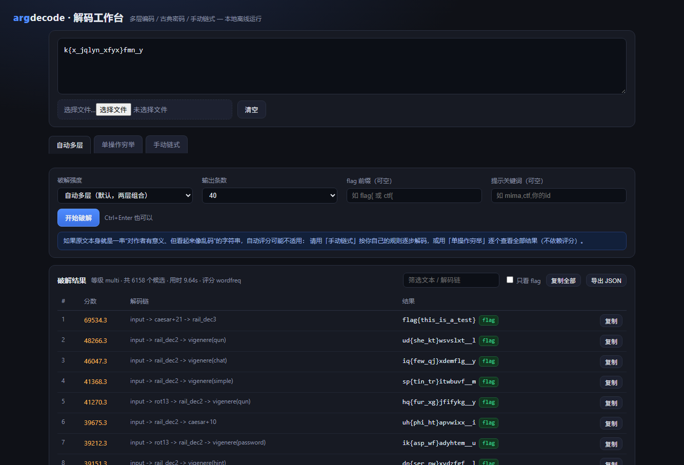

# argdecode —— 多层编码 / 古典密码自动破解工具

  

把一段可疑密文丢进去，自动尝试「常见编码 + 古典密码 + 多层组合」，
用英文词频、三字母组、flag 格式综合打分，把最像明文的候选排在最前面。

自带 **CLI** 和 **本地 Web 界面**（纯 Python 标准库，不联网、不上传数据）。



---

## English summary

**argdecode** is a self-contained CTF/cipher cracking tool: it brute-forces common
encodings (base64/base32/base58/base85, hex, URL, Morse, Bacon, A1Z26, binary, ...) and
classical ciphers (Caesar, affine, Atbash, rail fence, columnar transposition, Vigenère,
single-byte XOR), including **multi-layer chains** via BFS + beam search. Candidates are
ranked with an English word-frequency scorer (wordfreq optional, auto-detected).

```bash
pip install .            # or: python argdecode.py "lfxyyjua"
argdecode "k{x_jqlyn_xfyx}fmn_y" --level multi
argdecode-gui            # local web UI on 127.0.0.1:8765
```

---

## 特性

- **自动多层**：编码链 BFS + 古典密码单层穷举 + 波束搜索，能解「栅栏 + 凯撒」这类组合题。
- **词频评分**：可选 wordfreq；三层规则（flag 格式 / 常见词切分 / 少层优先）把「像人话」的答案顶上来。
- **Web 界面**：自动多层、单操作穷举、手动链式三个工作区，支持筛选、只看 flag、导出 JSON。
- **完全离线**：只依赖 Python 3.8+ 标准库，没有网络请求、不执行密文内容。
- **可扩展**：新增密码只需写一个 `fn(text, ...) -> str` 并注册到 `static_cipher_ops()` / `beam_ops()`。

## 安装

需要 Python 3.8+。

```bash
# 方式一：直接运行（无需安装任何东西）
python argdecode.py "lfxyyjua"

# 方式二：安装成命令
pip install .
argdecode "lfxyyjua"
argdecode-gui

# 可选：更强的词频评分
pip install .[full]     # 等价于 pip install wordfreq
```

## 快速开始

```bash
python argdecode.py "lfxyyjua"                 # 全自动
python argdecode.py -f cipher.txt               # 从文件读
echo -n "bGZ4eXlqdWE=" | python argdecode.py -  # 从 stdin 读
python argdecode.py "xxx" --layers 3 --top 40   # 更深的多层搜索
python argdecode.py "xxx" --deep                # 额外穷举列置换（较慢）
python argdecode.py "xxx" --json out.json       # 结果导出 JSON
python argdecode.py --list-ops                  # 查看全部操作
```

输出示例：

```text
==============================================================================
输入      : 'lfxyyjua'
候选总数  : 8412    耗时: 1.64s    评分引擎: wordfreq
==============================================================================
  #          分数  解码链                                           结果
------------------------------------------------------------------------------
  1      1304.7  input -> vigenere(arg) -> caesar+23          ilovearg
  ...
```

## Web 界面（推荐）

```bash
python argdecode_gui.py              # 默认 127.0.0.1:8765，自动打开浏览器
python argdecode_gui.py --port 9000 --no-browser
```

界面里分三个工作区：

| 工作区 | 用途 |
| --- | --- |
| **自动多层** | 一键破解；强度分「单层穷举 / 自动多层 / 深度多层」三档 |
| **单操作穷举** | 选一个操作族（凯撒 0~25、栅栏、仿射 312 组、维吉尼亚、XOR 1~255、列置换…），全部结果列出来，不依赖评分 |
| **手动链式** | 按顺序执行任意操作（如 `rot13 → rail:3 → caesar:8`），每一步都能看到中间结果 |

结果表支持筛选、只看 flag、单条复制、导出 JSON。

## 三种破解强度

| 强度 | 命令 | 说明 |
| --- | --- | --- |
| 单层 | `--level single` | 只对输入做一层古典密码穷举，快但解不了多层 |
| 多层 | `--level multi`（默认） | 两层组合波束搜索 |
| 深度 | `--level deep` | 三层组合 + 列置换穷举，慢但覆盖复杂题 |

## 手动链式解码（CLI）

```bash
python argdecode.py "密文" --chain "base64,caesar:5,rail:3"
python argdecode.py "密文" --chain "rot13,vigenere:arg"
```

## Windows 双击 / 拖拽

- **双击 `argdecode.bat`**：直接启动 Web 界面并自动打开浏览器。
- **把密文文件拖到 `argdecode.bat` 图标上**：按文件内容直接破解，窗口保留结果。
- **`argdecode.bat cli`**：命令行交互模式（粘贴密文回车）。
- **`argdecode.bat lfxyyjua` / `argdecode.bat --deep` 等**：参数原样转发给 CLI。
- 也可以双击 `argdecode-gui.bat` 只启动 Web 界面。

## 支持的操作

### 编码 / 转码
base64、base64url、base32、hex、base58、base85(RFC1924)、ascii85、
URL 编码、HTML 实体、Unicode 转义、二进制、十进制 ASCII、八进制、
A1Z26、摩斯电码、培根密码、ROT13、倒序。

### 古典密码
- 凯撒（26 种位移）
- 仿射（312 组 a,b）
- Atbash、ROT47、倒序
- 栅栏 / rail fence（加密方向 + 解密方向，2..N 栏）
- 栅栏分组 fence（两种方向）
- 列置换 columnar（关键词解密；`--deep` 时对 2..6 列全排列穷举）
- 维吉尼亚：内置 35 个常见密钥 + IC/卡方自动求密钥
- 单字节 XOR（输入是 hex 或字节流时自动尝试 1..255）

## 参数

| 参数 | 说明 | 默认 |
| --- | --- | --- |
| `text` / `-f FILE` / `-` | 密文、密文文件、stdin | — |
| `-m MODE` | 只执行一个操作，如 `caesar:5` `rail:3` `base64` `vigenere:key` `columnar:key` `xor:0x42` | — |
| `--level L` | `single` / `multi` / `deep` | `multi` |
| `--chain "op1,op2"` | 按给定顺序手动解码 | — |
| `--layers N` | 多层组合的最大层数 | 2 |
| `--beam N` | 每层保留的候选数（波束宽度） | 30 |
| `--top N` | 输出条数 | 20 |
| `--deep` | 穷举列置换，命中率更高但慢 | 关 |
| `--keys k1,k2` | 追加维吉尼亚密钥 | — |
| `--dict FILE` | 维吉尼亚密钥字典（每行一个） | — |
| `--keywords w1,w2` | 追加关键词，命中会大幅加分 | — |
| `--flag 'flag{'` | 指定 flag 前缀，强约束 | 自动匹配任意 `xxx{...}` |
| `--json FILE` | 导出完整结果 | — |
| `--all` | 打印所有候选 | 关 |
| `--max-rails N` | 栅栏最大栏数 | 12 |

## 工作流程

1. **编码链 BFS**：对输入反复套用所有编码解码，最多 `--codec-depth` 层，
   得到「input -> base64 -> base64」这类候选。
2. **种子挑选**：按评分取高分候选 + 全部纯字母候选作为种子。
3. **古典密码穷举**：每个种子跑一遍凯撒/仿射/栅栏/维吉尼亚/列置换等单层操作。
4. **波束搜索**：对最好的几个种子做多层组合（`--layers` 控制深度，`--beam` 控制每层宽度）。
5. **收尾**：对高分结果再套一层编码，覆盖「先加密后编码」的情况。

## 评分规则

- 命中 flag 格式（`xxx{...}`）：按前缀可信度给 1.5k～30k 分；前缀是 flag/ctf 等常见词、
  内部是真实英文单词时得分最高。
- 关键词命中（内置 CTF 词表 + `--keywords`）：大幅加分。
- 英文三字母组 / 双字母组覆盖率、元音比例、重复字母、冷门字母（q/x/z）惩罚。
- 可用时叠加 wordfreq 的词频（zipf）分数。
- 乱码字符（`^=~*<>` 等）重罚，避免 ROT47 之类的乱码排前面。
- **少层优先**：每多一层操作扣 45 分（`CHAIN_PENALTY`），两层能解的不会输给四层瞎凑的。
- **单词切分**：把字母串用词频表切成最少的常见词——
  1~3 个常见词拼成的整串（如 `i`+`love`+`arg`）额外加分；
  切完还剩字母碎片（如 `thisis`+`xq`）按碎片长度重罚。

## 项目结构

```text
argdecode/
├── argdecode.py          # 核心：编码/古典密码操作 + 评分 + 求解 + CLI
├── argdecode_gui.py      # 本地 Web 界面（标准库 http.server）
├── argdecode.bat         # Windows：双击启动 GUI / 交互 CLI / 拖文件
├── argdecode-gui.bat     # Windows：只启动 GUI
├── tests/                # 单元测试（unittest，无第三方依赖）
├── docs/screenshot.png   # 界面截图
├── pyproject.toml        # 安装配置（argdecode / argdecode-gui 两个命令）
└── LICENSE
```

## 开发与测试

```bash
python -m unittest discover -s tests -v
```

CI 在 GitHub Actions 上跑 Python 3.9 / 3.11 / 3.13。

想加新密码：在「古典密码」区写一个 `fn(text, ...) -> str`，
注册进 `static_cipher_ops()`（单层）和/或 `beam_ops()`（多层）即可。

## 说明

- 工具只做离线解码/穷举，不联网、不执行密文内容。
- 评分是启发式的：如果前几名都不像人话，可以 `--deep --layers 3 --top 50`，
  或者用 `-m` 逐个验证、用 `--keywords` 给出题面里的提示词。
- 仅供 CTF、密码学练习和授权测试使用。

## License

MIT
